<div align="center">

<picture>
  <source media="(prefers-color-scheme: dark)" srcset="docs/readme/banner-dark.svg">
  
</picture>

<p>
  <a href="https://apps.apple.com/app/id6832491263"><b>Download on the App Store</b></a> ·
  <a href="https://gabrielevierti.github.io/quota-support/"><b>Website</b></a> ·
  <a href="https://gabrielevierti.github.io/quota-support/privacy.html"><b>Privacy</b></a> ·
  <a href="#support"><b>Support</b></a>
</p>

</div>

This repository is the website of **Quota – Flight Radar**: the product page, the FAQ and support contact, and the privacy policy, published with GitHub Pages in English and Italian.

**Quota** shows live air traffic, weather and airports on one map, with tools for pilots and drone pilots, on iPhone, iPad, Mac (Apple silicon) and Apple Watch. Every feature is free and built on open data, with no ads, no account and no tracking.

<picture>
  <source media="(prefers-color-scheme: dark)" srcset="docs/readme/features-dark.svg">
  
</picture>

> [!IMPORTANT]
> Quota supports planning and situational awareness. It is **not** a navigation or weather-avoidance instrument: always use official charts, NOTAMs, briefings and your instruments. Drone zones are estimates, not official airspace.

## Support

Report a problem, data that doesn't match what you see, or an idea. Please include your device, the system version and the Quota version, and a screenshot if you can.

- **Email:** [gabriele.vierti@gmail.com](mailto:gabriele.vierti@gmail.com?subject=Quota)
- **GitHub:** [open an issue](../../issues)

**Privacy in one line:** Quota collects no data. Saved flights, history and settings stay on your devices and, if sync is on, in your own iCloud, which the developer can't read. Details in the [privacy policy](https://gabrielevierti.github.io/quota-support/privacy.html).

## About this repository

A static site with no build step:

| File | What it is |
| --- | --- |
| `index.html` | Product page, features, FAQ and support |
| `privacy.html` | Privacy policy |
| `style.css` | Styles |
| `app.js` | English / Italian switch (remembered in the browser) and the App Store button. The link is `APP_STORE_URL` at the top |
| `icon.png`, `favicon.png`, `apple-touch-icon.png`, `og-image.jpg` | Icons and the social preview image |

Preview it locally with any static server:

```sh
python3 -m http.server 8000    # then open http://localhost:8000
```

Pushing to the default branch updates the live site through GitHub Pages.

## Data sources

adsb.lol (ODbL), FlyItalyADSB (CC BY-SA 4.0), adsbdb.com, NOAA Aviation Weather Center, NOAA GFS, NOAA SWPC, Radar-DPC Protezione Civile (CC BY-SA 4.0), Smithsonian / USGS, OurAirports, OpenStreetMap (ODbL), CelesTrak, Planespotters.net, NOAA WMM, AWS Terrain Tiles, NASA GIBS (GPM IMERG, VIIRS).

---

<sub>© 2026 <a href="https://github.com/gabrielevierti">Gabriele Vierti</a>, Milan.</sub>
